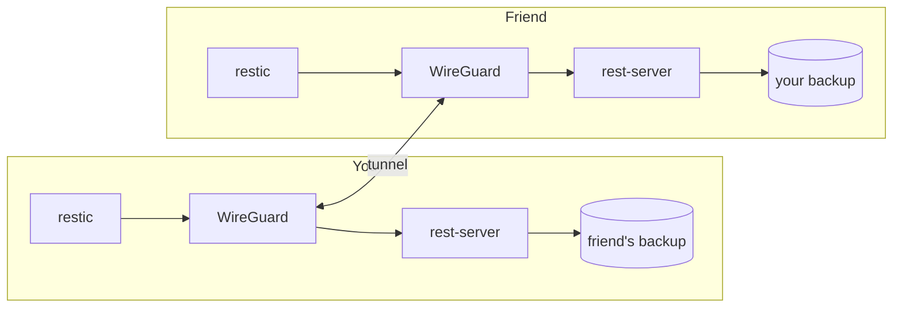

# offsite-swap

Swap encrypted off-site backups with a friend.

You keep your friend's backup, your friend keeps yours. Both sides run the same three containers:

- **restic** backs up your data every night. It encrypts everything before it leaves, so your friend can't read it.
- **rest-server** stores your friend's backup, append-only: they can add and restore, not delete. If their server gets hacked, their backup at your place survives.
- **WireGuard** connects you. Only these containers are in the tunnel: your friend reaches your rest-server and nothing else.

## You need

- Docker with Compose
- A folder for your friend's backup. On ZFS, give it its own dataset with a quota.
- A dynamic DNS name and a forwarded UDP port. If one side can't, that side just calls the other.

## Setup

Run as root.

1. Copy `.env.example` to `.env` and `compose.override.example.yaml` to `compose.override.yaml`, and fill them in.
2. `./offsite keys` and send the output to your friend.
3. Put your friend's public key in `.env` and add their login: `./offsite peer '<their login>'`
4. `./offsite up`
5. `./offsite init`
6. Put `secrets/restic-password` in your password manager. Without it, your backup is useless.

Backups run every night at 04:00. `./offsite status` shows the tunnel and your latest snapshots.
Need to prepare something first, like a database dump? Put a script in `hooks/`.

## Cleaning up

Append-only means old snapshots stay. Clean up well before the space runs out:
your friend makes a ZFS snapshot and removes `--append-only`, you run `./offsite prune`, and your friend puts it back.

## Updating

Always update the whole project at once: `docker compose pull && docker compose up -d`

## License

[BSD-3-Clause](LICENSE)
