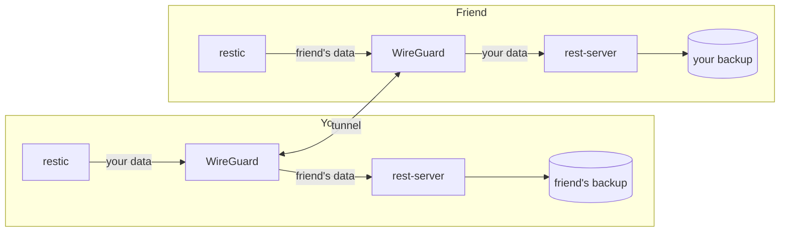

# offsite-swap

Swap encrypted off-site backups with a friend.

You keep your friend's backup, your friend keeps yours. Both sides run the same three containers:

- **restic** backs up your data every night. It encrypts everything before it leaves, so your friend can't read it.
- **rest-server** stores your friend's backup, append-only: they can add and restore, not delete. If their server gets hacked, their backup at your place survives.
- **WireGuard** connects you. Only these containers are in the tunnel. Your friend reaches your rest-server and nothing else, and the containers can't reach your network.

## You need

- Docker with Compose
- A folder for your friend's backup. On ZFS, give it its own dataset with a quota.
- A dynamic DNS name and a forwarded UDP port (51820). If one side can't, that side just calls the other.

## Setup

Run as root. Agree with your friend who uses tunnel address `.1` and who uses `.2`.

1. `git clone https://github.com/loopodoopo/offsite-swap.git && cd offsite-swap`
2. Copy `.env.example` to `.env` and `compose.override.example.yaml` to `compose.override.yaml`, and fill them in.
3. `./offsite keys` and send the output to your friend.
4. Put your friend's public key in `.env` and add their login: `./offsite peer '<their login>'`
5. `./offsite up`
6. `./offsite init`, once your friend has done step 5.
7. Put `secrets/restic-password` in your password manager. Without it, your backup is useless.

Backups run every night at 04:00. Was a server off, or your friend offline? Then it backs up as soon as both are on again (it looks every 15 minutes). The weekly check catches up the same way.

`./offsite status` shows the tunnel, your latest snapshots and whether your rest-server is append-only.

Need to prepare something first, like a database dump? Put a script in `hooks/`.
Want to hear when backups stop? Point `NOTIFY_OK_URL` at a dead man's switch, such as healthchecks.io.

## Restoring

`./offsite restore /some/folder` puts your latest snapshot there.

Lost your server? Set it up again, put your saved password in `secrets/restic-password`, run `./offsite keys` and send the new output to your friend.

## Cleaning up

Append-only means old snapshots stay. Clean up well before the space runs out:

1. Your friend makes a ZFS snapshot of your folder and runs `./offsite allow-prune`.
2. You run `./offsite prune`.
3. Your friend runs `./offsite append-only`.

## Updating

Update the whole project at once: `git pull && docker compose pull && ./offsite up`

## License

[BSD-3-Clause](LICENSE)
